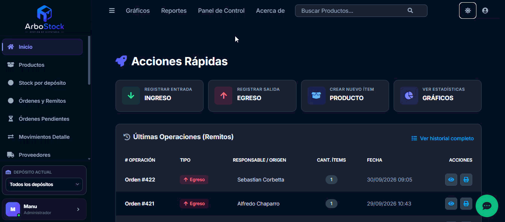
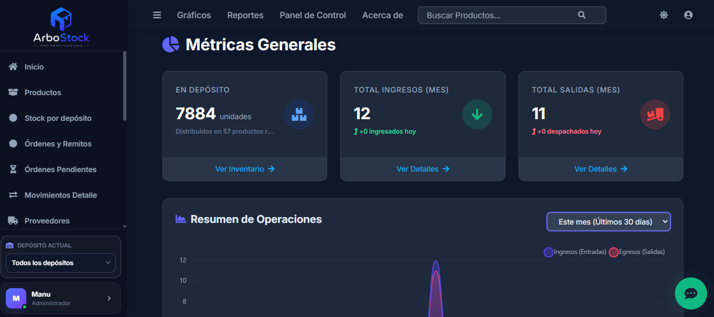
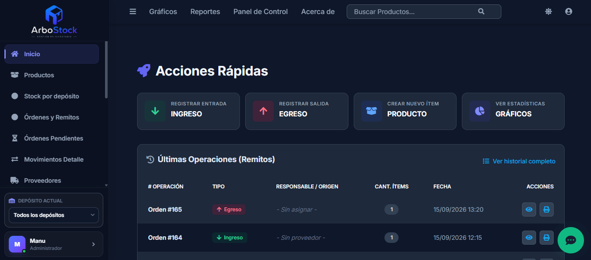
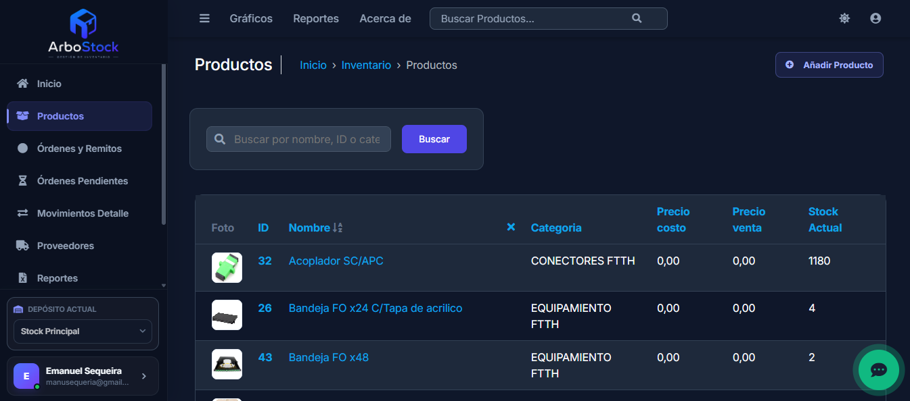
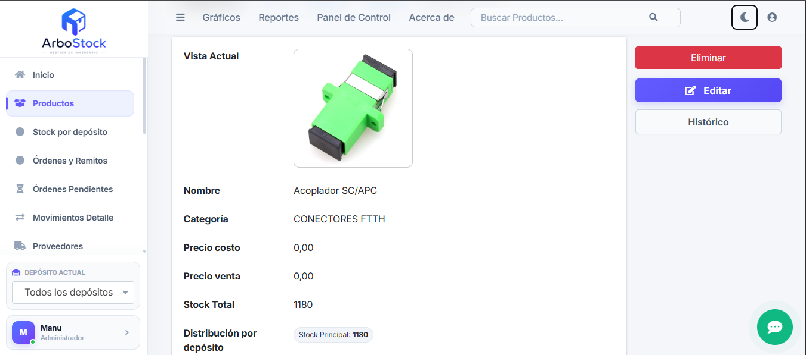
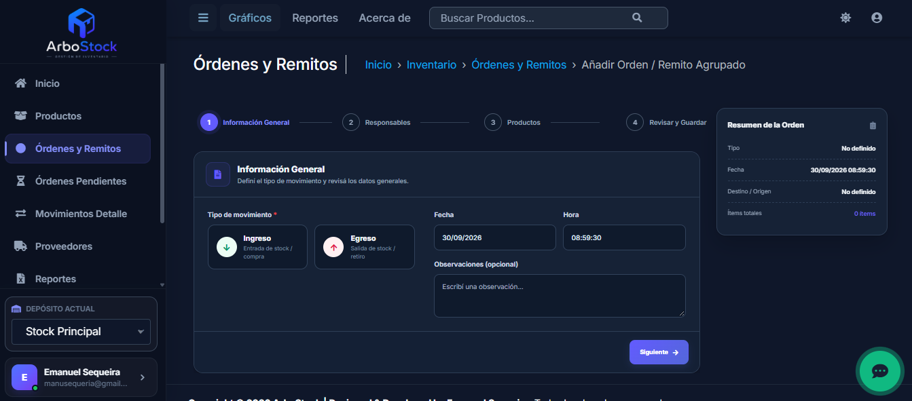
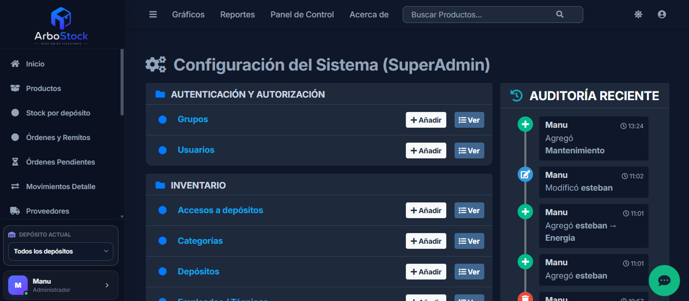
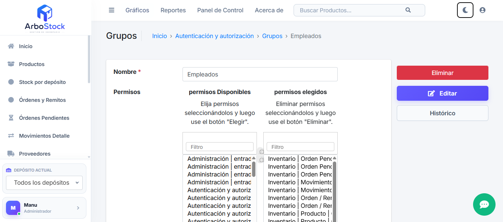

# 🌳 ArboStock - Sistema de Gestión de Stock

[](https://tu-app-arbostock.onrender.com)

**ArboStock** es una aplicación web desarrollada en Python y Django diseñada para gestionar el inventario de manera eficiente, permitiendo registrar ingresos, egresos y generar documentación detallada de cada operación con una interfaz moderna y minimalista.

---

## 📸 Vistas del Sistema

Aquí puedes ver todas las pantallas y funcionalidades del sistema en acción:

<div align="center">
  
</div>

<br>

<div align="center">
  
  
</div>
<br>
<div align="center">
  
  
</div>
<br>
<div align="center">
  
  
</div>
<br>
<div align="center">
  
  
</div>
<br>
<div align="center">
  
  
</div>

---

## 🚀 Características Principales

* **Gestión de Productos:** Alta, baja y modificación de productos con ID único.
* **Control de Movimientos:** Registro histórico y detallado de Ingresos y Egresos de stock.
* **Stock en Tránsito (Pendientes):** Sistema de borradores para ingresos programados. Permite registrar mercadería esperada y confirmarla con un solo clic una vez recibida físicamente, actualizando el stock y generando la orden automáticamente.
* **📄 Generación de Remitos:** Creación automática de comprobantes (remitos) digitales por cada movimiento de stock realizado.
* **Trazabilidad:** Registro automático de fecha, hora y usuario responsable de cada operación.
* **Gestión de Proveedores:** Vinculación de ingresos con proveedores específicos.
* **Seguridad y Permisos:** Administración granular de usuarios y grupos para controlar de forma exacta quién accede y qué puede modificar.
* **Reportes Avanzados:**
    * 📄 Exportación a **PDF** (usando xhtml2pdf)[cite: 1].
    * 📊 Exportación a **Excel** (usando openpyxl)[cite: 1].
* **Interfaz SaaS Moderna:** Panel de administración optimizado visualmente mediante la combinación de **Jazzmin y Tailwind CSS**, ofreciendo un diseño responsivo, limpio, tarjetas interactivas y soporte sincronizado para Modo Claro/Oscuro.

## 🛠️ Tecnologías Utilizadas

* **Lenguaje:** Python 3.10+[cite: 1]
* **Framework Web:** Django 5.x[cite: 1]
* **Base de Datos:** SQLite (Local) / **PostgreSQL Serverless vía Neon** (Producción)[cite: 1]
* **Infraestructura:** Docker, Render[cite: 1]
* **Estilos y UI:** Bootstrap / Jazzmin Theme / **Tailwind CSS (Utility-First)** / CSS Personalizado[cite: 1]
* **Librerías Clave:**
    * `django-jazzmin`: Interfaz de administración profesional[cite: 1].
    * `Tailwind CSS`: Estilos modernos orientados a componentes tipo SaaS.
    * `xhtml2pdf`: Generación de reportes y remitos en PDF[cite: 1].
    * `openpyxl`: Exportación de datos a Excel[cite: 1].
    * `whitenoise`: Gestión eficiente de archivos estáticos[cite: 1].
    * `dj-database-url` y `gunicorn`: Conexión dinámica a BD y servidor para producción[cite: 1].

## 💻 Instalación Local

Sigue estos pasos para correr el proyecto en tu propia máquina:

1.  **Clonar el repositorio:**
    ```bash
    git clone [https://github.com/Manuseq94/ArboStock.git](https://github.com/Manuseq94/ArboStock.git)
    cd ArboStock
    ```

2.  **Crear y activar un entorno virtual:**
    ```bash
    # Windows:
    python -m venv .venv
    .venv\Scripts\activate
    
    # Mac/Linux:
    python3 -m venv .venv
    source .venv/bin/activate
    ```

3.  **Configurar variables de entorno locales:**
    Crea un archivo `.env` en la raíz del proyecto para asegurar tus credenciales locales:
    ```env
    DJANGO_SECRET_KEY=tu_clave_secreta_local
    DJANGO_DEBUG=True
    ```

4.  **Instalar dependencias:**
    ```bash
    pip install -r requirements.txt
    ```

5.  **Realizar migraciones de base de datos (SQLite):**
    ```bash
    python manage.py migrate
    ```

6.  **Crear un Superusuario (Administrador):**
    Para acceder al panel de control total, necesitas crear un usuario con permisos:
    ```bash
    python manage.py createsuperuser
    ```
    *Sigue las instrucciones en pantalla para definir usuario, correo y contraseña.*

7.  **Correr el servidor:**
    ```bash
    python manage.py runserver
    ```
    Accede a: `http://127.0.0.1:8000/admin/`[cite: 1]

## 👥 Gestión de Usuarios y Roles

El sistema permite gestionar diferentes niveles de acceso desde el panel de administración de manera súper flexible a través del uso de **Grupos y Permisos**[cite: 1]:
* **Superusuario:** Tiene control total sobre la configuración, usuarios y base de datos[cite: 1].
* **Staff (Equipo):** Se pueden crear usuarios y asignarlos a Grupos con permisos limitados (ej: grupo "Depósito" para solo cargar stock, o grupo "Ventas" para generar salidas), ideal para empleados o encargados, sin darles acceso a configuraciones sensibles ni a la gestión de otros usuarios[cite: 1].

## 🐳 Arquitectura y Despliegue en Producción

Este proyecto cuenta con una arquitectura moderna de microservicios, lista para ser desplegada en la nube con un flujo de integración continuo (CI/CD)[cite: 1]:

* **Contenerización:** Incluye `Dockerfile` y `entrypoint.sh` para construir una imagen de Docker inmutable. Esto garantiza que la aplicación funcione exactamente igual en desarrollo y en producción sin conflictos de dependencias[cite: 1].
* **Plataforma (Hosting):** Servidor web optimizado para un despliegue continuo en **Render**[cite: 1].
* **Base de Datos Desacoplada:** La aplicación se conecta dinámicamente a **Neon DB (PostgreSQL Serverless)** a través de variables de entorno (`DATABASE_URL`), garantizando seguridad, persistencia absoluta de los datos y alta disponibilidad, independientemente del ciclo de vida del contenedor web[cite: 1].

---
* [LinkedIn](https://www.linkedin.com/in/emanuel-sequeria-a8360b231?utm_source=share_via&utm_content=profile&utm_medium=member_ios)[cite: 1]
* [GitHub](https://github.com/Manuseq94)[cite: 1]
---
Desarrollado por **Emanuel Sequeira**[cite: 1].
