# 🌳 ArboStock - Sistema de Gestión de Stock

[](https://tu-app-arbostock.onrender.com)

**ArboStock** es una aplicación web desarrollada en Python y Django diseñada para gestionar el inventario de manera eficiente, permitiendo registrar ingresos, egresos y generar documentación detallada de cada operación con una interfaz moderna y minimalista.

---

> Documentación técnica (arquitectura, instalación, tests, ramas y despliegue): [docs/TECNICO.md](docs/TECNICO.md).
> Manual de uso: dentro de la app, en **Ayuda y atajos → Manual** (`/ayuda/manual/`), con un botón **?** en cada pantalla principal.

## 📸 Vistas del Sistema

Aquí puedes ver todas las pantallas y funcionalidades del sistema en acción:

<!-- capturas:inicio -->
<div align="center">
  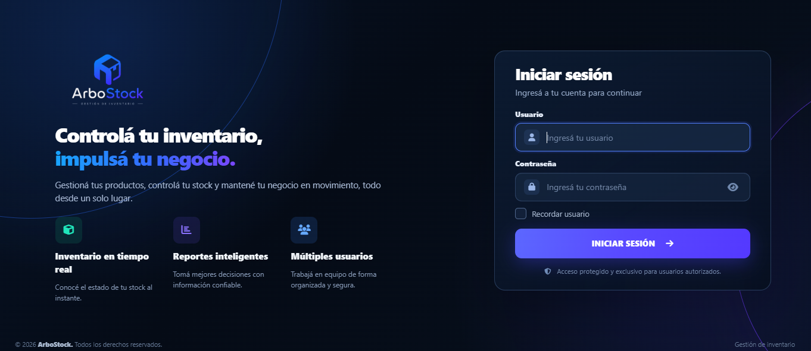
  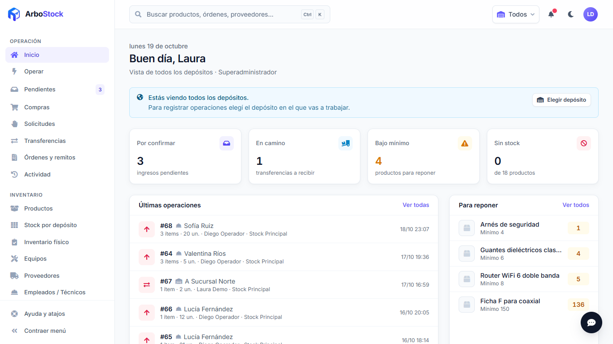
</div>
<br>
<div align="center">
  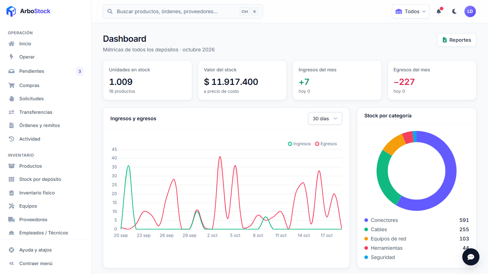
  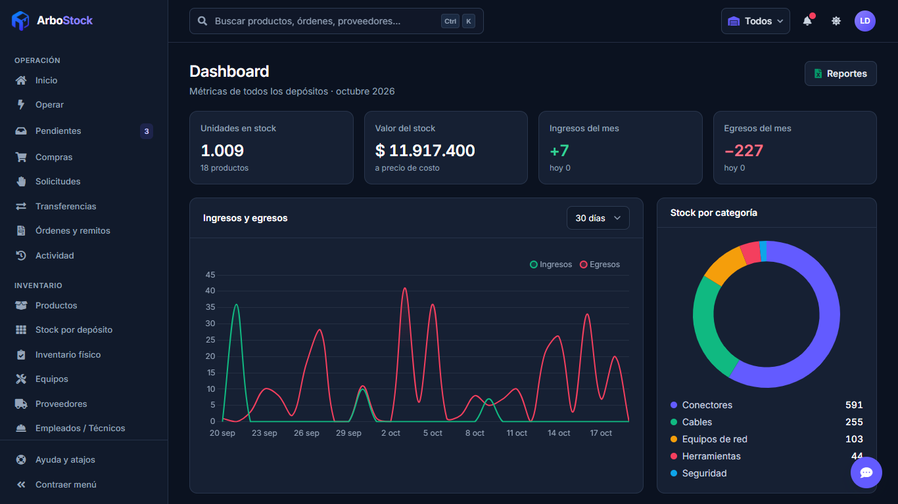
</div>
<br>
<div align="center">
  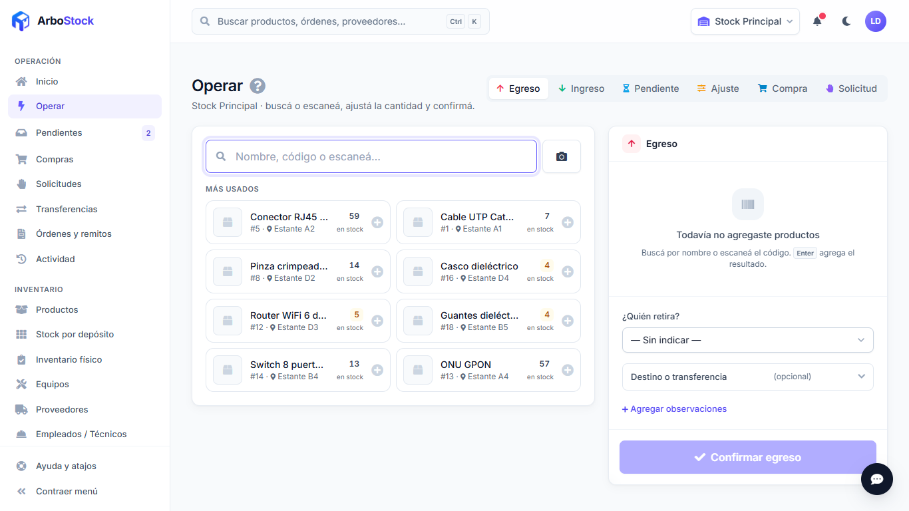
  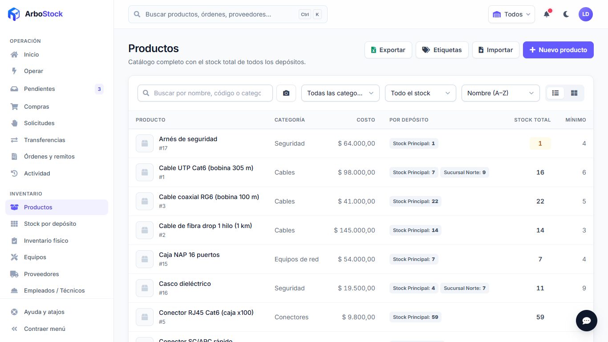
</div>
<br>
<div align="center">
  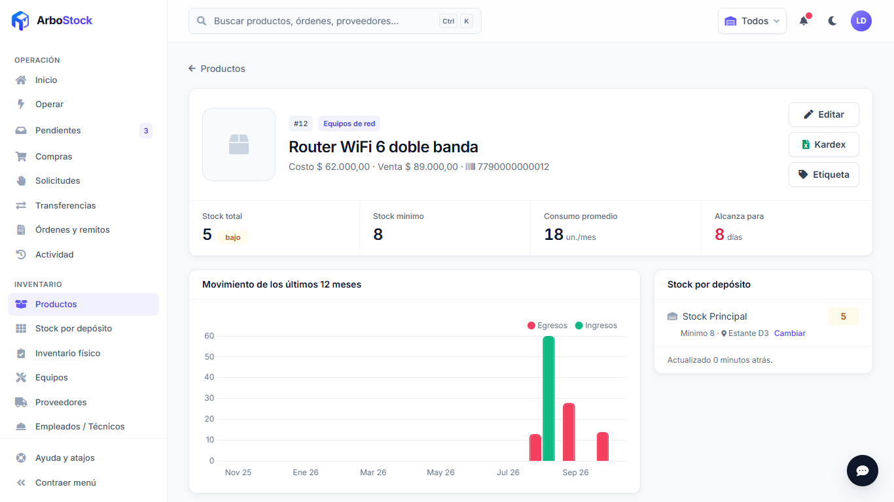
  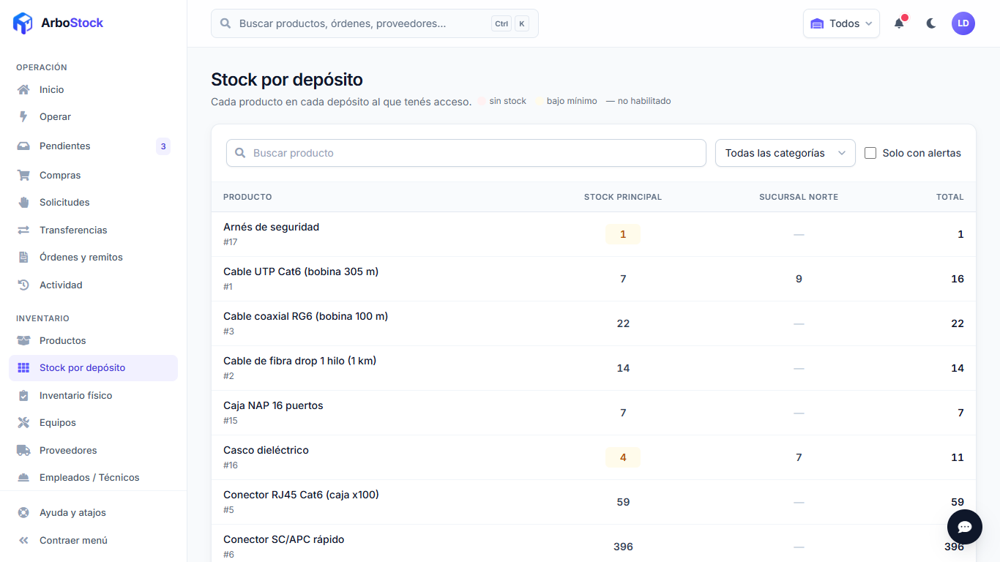
</div>
<br>
<div align="center">
  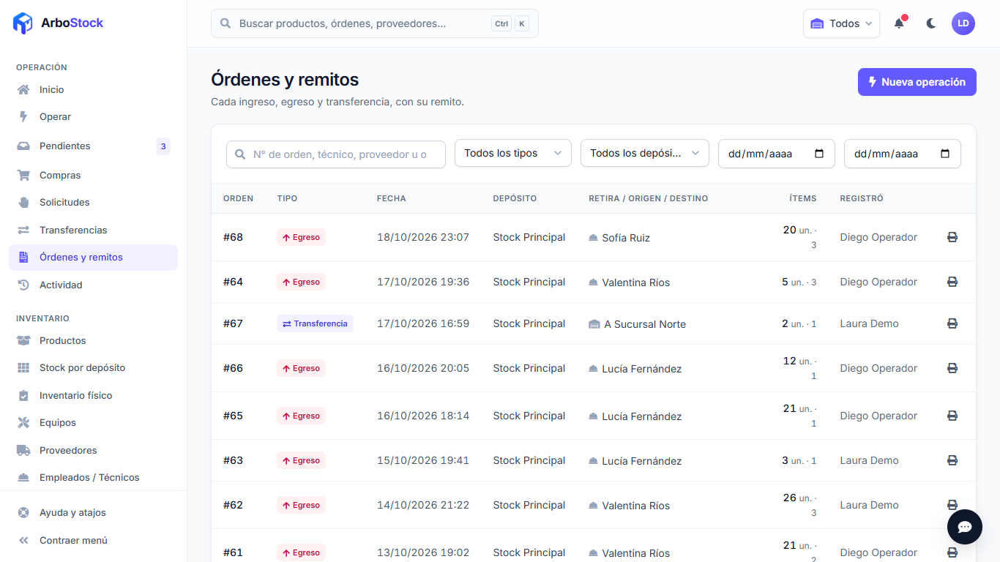
  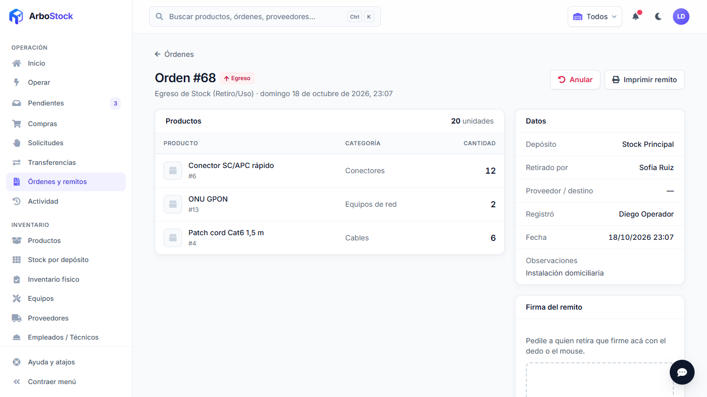
</div>
<br>
<div align="center">
  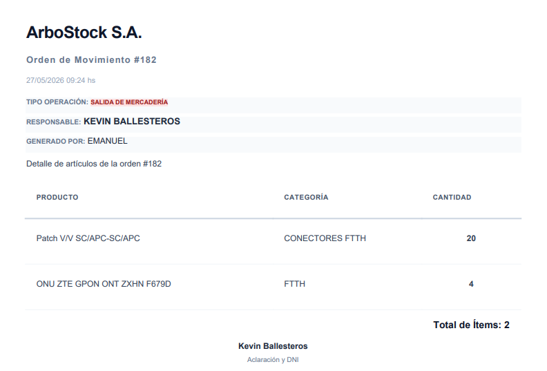
  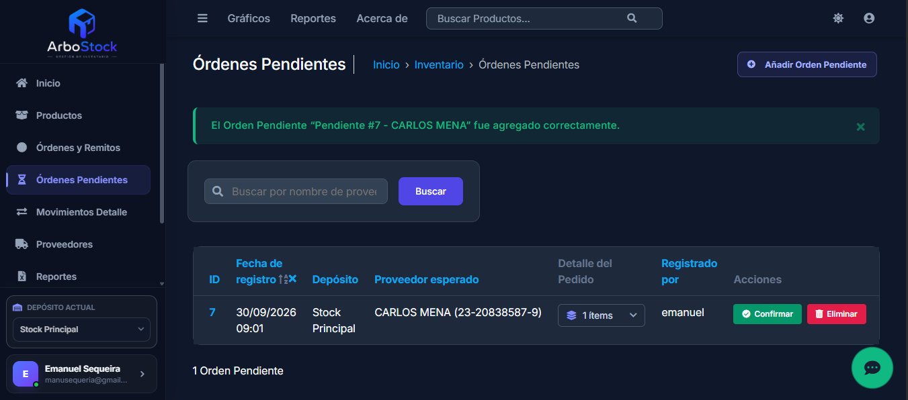
</div>
<br>
<div align="center">
  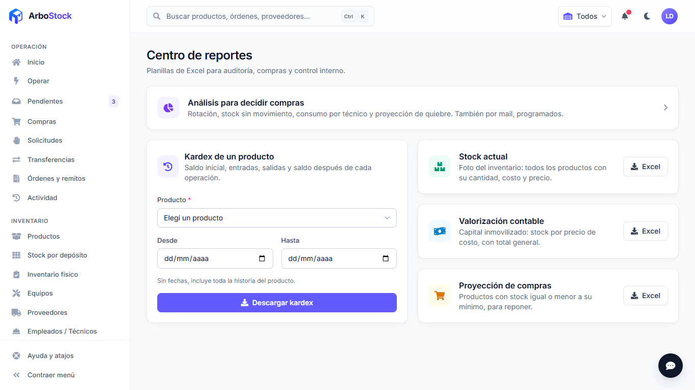
  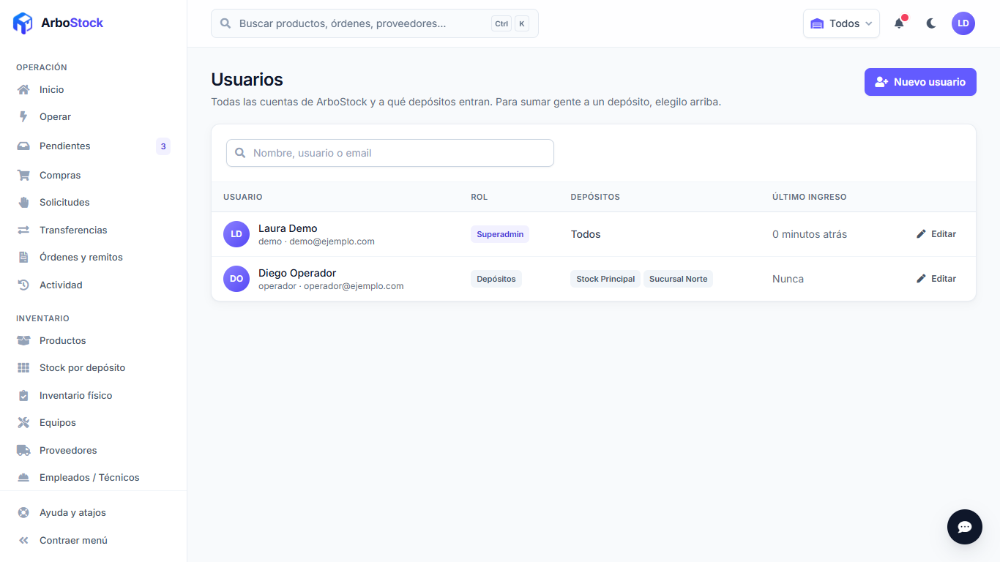
</div>
<br>
<div align="center">
  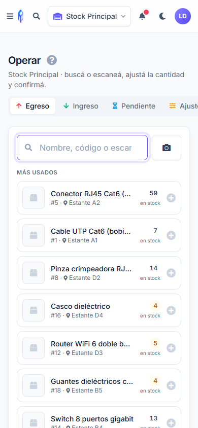
  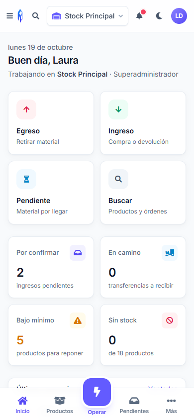
</div>

<sub>Capturas con datos ficticios, generadas con <code>scripts/capturas_readme.py</code>.</sub>
<!-- capturas:fin -->

---

## 🚀 Características Principales

* **Gestión de Productos:** Alta, baja y modificación de productos con ID único.
* **Control de Movimientos:** Registro histórico y detallado de Ingresos y Egresos de stock.
* **Stock en Tránsito (Pendientes):** Sistema de borradores para ingresos programados. Permite registrar mercadería esperada y confirmarla con un solo clic una vez recibida físicamente, actualizando el stock y generando la orden automáticamente.
* **📄 Generación de Remitos:** Creación automática de comprobantes (remitos) digitales por cada movimiento de stock realizado.
* **Trazabilidad:** Registro automático de fecha, hora y usuario responsable de cada operación.
* **Gestión de Proveedores:** Vinculación de ingresos con proveedores específicos.
* **Seguridad y Permisos:** Administración granular de usuarios y grupos para controlar de forma exacta quién accede y qué puede modificar.
* **Reportes Avanzados:**
    * 📄 Exportación a **PDF** (usando xhtml2pdf)[cite: 1].
    * 📊 Exportación a **Excel** (usando openpyxl)[cite: 1].
* **Interfaz SaaS Moderna:** Panel de administración optimizado visualmente mediante la combinación de **Jazzmin y Tailwind CSS**, ofreciendo un diseño responsivo, limpio, tarjetas interactivas y soporte sincronizado para Modo Claro/Oscuro.

## 🛠️ Tecnologías Utilizadas

* **Lenguaje:** Python 3.10+[cite: 1]
* **Framework Web:** Django 5.x[cite: 1]
* **Base de Datos:** SQLite (Local) / **PostgreSQL Serverless vía Neon** (Producción)[cite: 1]
* **Infraestructura:** Docker, Render[cite: 1]
* **Estilos y UI:** Bootstrap / Jazzmin Theme / **Tailwind CSS (Utility-First)** / CSS Personalizado[cite: 1]
* **Librerías Clave:**
    * `django-jazzmin`: Interfaz de administración profesional[cite: 1].
    * `Tailwind CSS`: Estilos modernos orientados a componentes tipo SaaS.
    * `xhtml2pdf`: Generación de reportes y remitos en PDF[cite: 1].
    * `openpyxl`: Exportación de datos a Excel[cite: 1].
    * `whitenoise`: Gestión eficiente de archivos estáticos[cite: 1].
    * `dj-database-url` y `gunicorn`: Conexión dinámica a BD y servidor para producción[cite: 1].

## 💻 Instalación Local

Sigue estos pasos para correr el proyecto en tu propia máquina:

1.  **Clonar el repositorio:**
    ```bash
    git clone [https://github.com/Manuseq94/ArboStock.git](https://github.com/Manuseq94/ArboStock.git)
    cd ArboStock
    ```

2.  **Crear y activar un entorno virtual:**
    ```bash
    # Windows:
    python -m venv .venv
    .venv\Scripts\activate
    
    # Mac/Linux:
    python3 -m venv .venv
    source .venv/bin/activate
    ```

3.  **Configurar variables de entorno locales:**
    Crea un archivo `.env` en la raíz del proyecto para asegurar tus credenciales locales:
    ```env
    DJANGO_SECRET_KEY=tu_clave_secreta_local
    DJANGO_DEBUG=True
    ```

4.  **Instalar dependencias:**
    ```bash
    pip install -r requirements.txt
    ```

5.  **Realizar migraciones de base de datos (SQLite):**
    ```bash
    python manage.py migrate
    ```

6.  **Crear un Superusuario (Administrador):**
    Para acceder al panel de control total, necesitas crear un usuario con permisos:
    ```bash
    python manage.py createsuperuser
    ```
    *Sigue las instrucciones en pantalla para definir usuario, correo y contraseña.*

7.  **Correr el servidor:**
    ```bash
    python manage.py runserver
    ```
    Accede a: `http://127.0.0.1:8000/inicio/`

8.  **Correr los tests:**
    ```bash
    python manage.py test inventario web
    ```
    En GitHub corren solos en cada push (`.github/workflows/tests.yml`): tests contra PostgreSQL 18 (la versión de Neon), migraciones desde cero, `collectstatic` y verificación de que el CSS compilado esté al día.

## 🎨 Pantallas, estilos y librerías (frontend)

Las pantallas de uso diario (inicio, operar, productos, stock, órdenes, pendientes, transferencias, proveedores, empleados, usuarios, dashboard, reportes, perfil) viven en la app `web`, con plantillas de Django + HTMX + Alpine.js y un sistema de diseño propio con Tailwind. El admin de Django (`/admin/configuracion/`) queda para configuración: categorías, depósitos, usuarios globales, grupos y permisos.

Las reglas de negocio de stock (registrar órdenes, transferencias, pendientes, productos por depósito) están en `inventario/services/` y las usan tanto el admin como las pantallas nuevas.

**No hace falta Node para correr la app ni para desplegarla:** el CSS compilado y las librerías de terceros están en el repo (`static/css/app.css`, `static/css/admin_tailwind.css`, `static/vendor/`). Node solo se usa al cambiar estilos o íconos:

```bash
npm install            # una vez
npm run watch:css      # mientras se trabaja en las plantillas de la app web
npm run build          # antes de commitear: librerías, íconos y CSS compilados
```

| Comando | Qué hace |
|---|---|
| `npm run build:css` | Compila `assets/css/app.css` (app web) y `assets/css/admin_tailwind.css` (admin) con Tailwind. |
| `npm run iconos` | Genera el subconjunto de Font Awesome con los íconos que usan las pantallas (si agregás un ícono, correlo; el test `web.tests.test_iconos` avisa si falta). |
| `npm run vendor` | Copia HTMX, Alpine, Chart.js, Font Awesome e Inter a `static/vendor/` (sin CDNs externos). |

Rendimiento: los estáticos se sirven con nombre versionado y comprimidos (WhiteNoise, caché de un año), el HTML va comprimido (GZip) y cada respuesta trae un encabezado `Server-Timing` con el tiempo total, el de la base y la cantidad de consultas. Los pedidos más lentos que `ARBOSTOCK_UMBRAL_LENTO_MS` (800 ms por defecto) quedan en el log.

Variables de entorno nuevas (ver `deploy/*.env.example`): `GUNICORN_THREADS`, `DJANGO_CONN_MAX_AGE`, `ARBOSTOCK_UMBRAL_LENTO_MS` y las de mail (`EMAIL_HOST`, `EMAIL_PORT`, `EMAIL_HOST_USER`, `EMAIL_HOST_PASSWORD`, `EMAIL_USE_TLS`, `DEFAULT_FROM_EMAIL`) para las invitaciones de usuarios. Sin `EMAIL_HOST`, los mails se escriben en el log y la pantalla de usuarios muestra el enlace de activación para compartirlo a mano.

## 💲 Costos y centros de costo

* **Costo promedio ponderado:** cada recepción de una orden de compra con precio actualiza el costo del producto: (stock × costo actual + cantidad × precio) / (stock + cantidad). Ese es el costo que usan la valorización y los análisis.
* Cada movimiento guarda su **costo unitario**: los egresos salen al costo promedio del momento; ajustes, cargas e inventarios se valorizan al promedio sin cambiarlo.
* **Centros de costo** (obras, proyectos, sectores) por empresa, en Administración → Mi empresa (o Empresas y depósitos). En un egreso se elige a cuál se imputa; **Reportes → Análisis → Consumo por centro de costo** muestra lo consumido valorizado.

## 🛒 Órdenes de compra

Quien administra el depósito arma el pedido desde **Operar → Compra** (proveedor y productos); queda como borrador para cargar precios y fecha estimada, y al **enviarla** el proveedor recibe el PDF por mail (si tiene email). Lo que llega se registra **contra la orden**, también en partes: cada recepción es un ingreso vinculado y la orden pasa a "Recibida en parte" o "Recibida". Si el resto no va a llegar, se cierra con faltantes.

## 🧰 Equipos con número de serie

En **Equipos**: herramientas y equipos con su número de serie. Quien administra el depósito da de alta las series de unidades que ya están en stock. **Asignar** un equipo a un empleado registra un egreso de 1 unidad a su nombre; la **devolución**, un ingreso; la **baja** (rotura, pérdida, robo) un ajuste con motivo. Cada equipo muestra quién lo tiene desde cuándo y todo su historial, y se puede filtrar por empleado.

## 📊 Análisis y reportes programados

En **Reportes → Análisis**: rotación de productos, stock sin movimiento (capital inmovilizado), consumo por técnico o cuadrilla y proyección de quiebre (en cuántos días se termina cada producto al ritmo actual). Cada uno se ve en pantalla, se descarga en Excel y se puede **recibir por mail** todos los días, una vez por semana o el primer día del mes, a las 7. Solo cuenta la operación real: anulaciones, ajustes, cargas e inventarios no son consumo.

## 🙋 Solicitudes internas

Un sector, obra o cuadrilla pide materiales desde **Operar → Solicitud** (cualquiera con acceso al depósito, también con perfil de consulta). Quien registra egresos en el depósito la **aprueba** (puede ajustar cantidades según el stock), la **rechaza** con motivo o la **entrega**: la entrega registra el egreso y queda vinculada. Los suscriptos a las alertas del depósito reciben un mail con cada solicitud nueva; quien pidió, con cada respuesta. La campanita muestra las que esperan aprobación.

## 🏷️ Códigos de barras, ubicaciones y escaneo

* Cada producto puede tener su **código de barras** (EAN, UPC o el de la etiqueta), único dentro de la empresa. El mostrador, la lista de productos y la toma de inventario lo encuentran al escanearlo.
* **Lector USB:** funciona en cualquier buscador (escribe el código y aprieta Enter).
* **Cámara del celular:** botón con el ícono de cámara junto al buscador. Usa el lector del navegador (Chrome/Android) o, si no lo tiene (iPhone), uno propio. **Requiere que ArboStock se abra con `https://`**: los navegadores no dan la cámara en páginas `http://` (salvo `localhost`).
* **Ubicación** (pasillo, estante) por depósito: se carga en la ficha del producto (junto al mínimo) o desde el Excel de importación. Se ve en el mostrador y ordena la toma de inventario.
* **Etiquetas:** botón "Etiquetas" en Productos (según los filtros) o "Etiqueta" en la ficha: PDF A4 de 3 × 8 con código de barras, nombre y ubicación. Si el producto no tiene código, se usa su número interno.

## ✍️ Remito con firma, QR y logo

* **Firma en pantalla:** en el detalle de la orden, quien retira o entrega firma con el dedo o el mouse y escribe su aclaración. Se firma una sola vez y queda en Actividad. La imagen se guarda en el almacenamiento de archivos (Cloudinary cuando está configurado).
* **QR de verificación:** cada remito impreso tiene un QR con un código imposible de adivinar. Escaneándolo, cualquiera (sin usuario) ve que el remito es auténtico, qué incluye, si está firmado y si se anuló. Usa `ARBOSTOCK_URL_PUBLICA` para armar el enlace.
* **Logo:** se carga en Administración → Mi empresa y aparece en el remito y en la página de verificación.

## 🔐 Seguridad de las cuentas

* **Verificación en dos pasos** (Mi perfil → Seguridad): se escanea un QR con Google Authenticator, Microsoft Authenticator o similar y, desde ahí, al entrar se pide también el código de 6 dígitos. Se entregan 8 códigos de respaldo de un solo uso por si se pierde el celular. Si se pierden ambos, el superadministrador la quita desde Administración → Todos los usuarios → (el usuario).
* **Contraseñas:** al menos 10 caracteres, con letras y números, no comunes ni parecidas al usuario. Rige para las contraseñas nuevas o al cambiarlas.
* **Bloqueo:** 5 intentos fallidos en 15 minutos bloquean ese usuario desde esa conexión hasta que pase el tiempo.

## 🔌 API y avisos a otros sistemas

Otro sistema (facturación, ERP) puede consultar productos, stock y órdenes, y registrar ingresos y egresos, con un **token** que se crea en *Mi empresa → Integraciones*. Los **webhooks** le avisan a ese sistema (POST JSON firmado con HMAC-SHA256) cada vez que se registra una orden o un producto llega a su mínimo. Detalle completo en [docs/API.md](docs/API.md).

## 🆕 Registro de empresas nuevas

Con `ARBOSTOCK_REGISTRO_ABIERTO=True`, el login ofrece **Crear una cuenta**: alguien de una empresa nueva completa sus datos, recibe un mail de confirmación (vale 3 días) y al confirmarlo se crean su empresa, su primer depósito y su usuario administrador; entra directo a los primeros pasos. Por defecto el registro está cerrado.

En **Mi empresa** (menú Administración), quien administra la empresa cambia el nombre, el CUIT y el logo de los remitos, y crea depósitos nuevos.

## 🏢 Varias empresas

Cada depósito y cada producto pertenecen a una **empresa** (Administración → Empresas y depósitos para el superadministrador; Mi empresa para quien la administra). Los datos no se mezclan: las transferencias van solo a depósitos de la misma empresa y un producto se habilita solo en depósitos de su empresa. El remito lleva el nombre (y en adelante el logo) de la empresa del depósito.

Al actualizar, todo lo que ya existe queda en una empresa llamada como indique `ARBOSTOCK_EMPRESA` en el `.env` (o "Mi empresa", que se renombra desde Administración → Empresas y depósitos). Con una sola empresa, la app se ve igual que antes.

## 📋 Toma de inventario físico

En **Inventario físico** (menú lateral):

1. Quien administra el depósito abre la toma: todos los productos activos o los de una categoría. Hay una sola abierta por depósito.
2. Todos los que operan en el depósito cargan lo que cuentan (desde el celular, buscando o escaneando el código; Enter guarda y pasa al siguiente). No ven el stock del sistema: el conteo es a ciegas. También se puede imprimir la planilla de conteo.
3. Quien administra ve las diferencias y aprueba: se registran como una orden de "Toma de inventario". Los productos sin contar no se tocan.

Se puede seguir operando durante la toma: cada conteo se compara con el stock del momento en que se contó, así un retiro posterior no se cuenta como faltante.

## 📥 Importar productos desde Excel

En **Productos → Importar** (para quien administra el depósito y el superadministrador):

1. Se descarga la plantilla, vacía o con el catálogo actual del depósito para editarlo en bloque.
2. Se completa: una fila por producto (código, nombre, categoría, descripción, precios, stock mínimo y stock). Una celda vacía deja el valor como está.
3. Se sube el `.xlsx` o `.csv` y se ve una vista previa con lo que se crea, lo que cambia y los errores fila por fila. Nada se guarda hasta confirmar; las filas con error se saltean.

La columna Stock es el stock contado: la diferencia entra como una orden de "Carga desde Excel" con motivo, así el historial explica el saldo. Hasta 2000 filas y 5 MB por archivo.

## 🔔 Stock mínimo por depósito y alertas

Cada depósito tiene su propio stock mínimo por producto. Se cambia desde la ficha del producto (bloque "Stock por depósito" → Cambiar), y pueden hacerlo quien administra ese depósito y el superadministrador. El "mínimo sugerido" del producto es el valor con el que arranca al habilitarlo en un depósito nuevo.

Cuando un producto queda en su mínimo o por debajo, se abre una alerta; al reponerlo, se cierra:

* **Campanita:** muestra en todo momento cuántos productos están bajo el mínimo o sin stock.
* **Mail:** se manda uno por cada cruce del mínimo (no uno por cada retiro) a quienes se suscriban al depósito en **Mi perfil → Alertas**. Usa la misma cuenta de mail que las invitaciones, y el enlace usa `ARBOSTOCK_URL_PUBLICA`.

## 📒 Historial inmutable y conciliación del stock

Las órdenes y sus movimientos no se editan ni se borran: el stock ya cambió con ellos. Un producto con movimientos tampoco se puede borrar (se desactiva). Para corregir un error se anula la orden o se registra un ajuste.

Correcciones (F3), para quien administra el depósito y el superadministrador:

* **Anular una orden** (botón en el detalle de la orden, con motivo): se registra la orden opuesta con los mismos productos. La original queda marcada como anulada. Una transferencia en camino descarta el pendiente del destino. Una transferencia ya recibida se revierte transfiriendo el material de vuelta.
* **Ajuste de stock** (Operar → Ajuste): se escribe el stock contado de cada producto y el motivo; la diferencia se registra como un ajuste que suma y/o uno que resta.
* **Actividad** (menú lateral): historial de quién hizo qué y cuándo (órdenes, anulaciones, ajustes, pendientes y productos). No se edita ni se borra.

Las anulaciones, los ajustes y las órdenes anuladas no cuentan en las métricas de consumo y compras (dashboard, ficha del producto). El kardex sí los muestra, porque explican el saldo.

`python manage.py reconciliar_stock [--deposito ID]` compara el stock de cada depósito con la suma de sus movimientos (ingresos − egresos). Solo lee: lista las diferencias y termina con código 1 si encuentra alguna. En el servidor se corre con `docker compose -f compose.prod.yml exec web python manage.py reconciliar_stock`.

Si hay diferencias, `reconciliar_stock --regularizar --usuario NOMBRE --motivo "..."` registra los ajustes que las explican **sin cambiar el saldo**. Después, si el conteo físico no coincide con el sistema, se hace un ajuste normal desde Operar.

## 👥 Gestión de Usuarios y Roles

El sistema permite gestionar diferentes niveles de acceso desde el panel de administración de manera súper flexible a través del uso de **Grupos y Permisos**[cite: 1]:
* **Superusuario:** Tiene control total sobre la configuración, usuarios y base de datos[cite: 1].
* **Staff (Equipo):** Se pueden crear usuarios y asignarlos a Grupos con permisos limitados (ej: grupo "Depósito" para solo cargar stock, o grupo "Ventas" para generar salidas), ideal para empleados o encargados, sin darles acceso a configuraciones sensibles ni a la gestión de otros usuarios[cite: 1].

## 🐳 Arquitectura y Despliegue en Producción

Este proyecto cuenta con una arquitectura moderna de microservicios, lista para ser desplegada en la nube con un flujo de integración continuo (CI/CD)[cite: 1]:

* **Contenerización:** Incluye `Dockerfile` y `entrypoint.sh` para construir una imagen de Docker inmutable. Esto garantiza que la aplicación funcione exactamente igual en desarrollo y en producción sin conflictos de dependencias[cite: 1].
* **Plataforma (Hosting):** Servidor web optimizado para un despliegue continuo en **Render**[cite: 1].
* **Base de Datos Desacoplada:** La aplicación se conecta dinámicamente a **Neon DB (PostgreSQL Serverless)** a través de variables de entorno (`DATABASE_URL`), garantizando seguridad, persistencia absoluta de los datos y alta disponibilidad, independientemente del ciclo de vida del contenedor web[cite: 1].

---
* [LinkedIn](https://www.linkedin.com/in/emanuel-sequeria-a8360b231?utm_source=share_via&utm_content=profile&utm_medium=member_ios)[cite: 1]
* [GitHub](https://github.com/Manuseq94)[cite: 1]
---
Desarrollado por **Emanuel Sequeira**[cite: 1].
