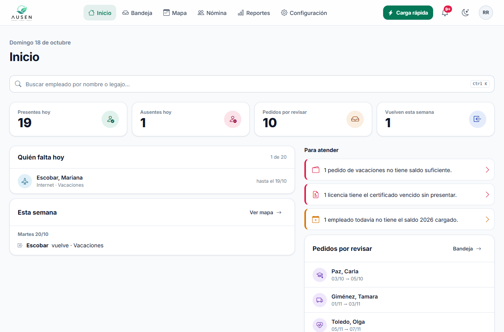
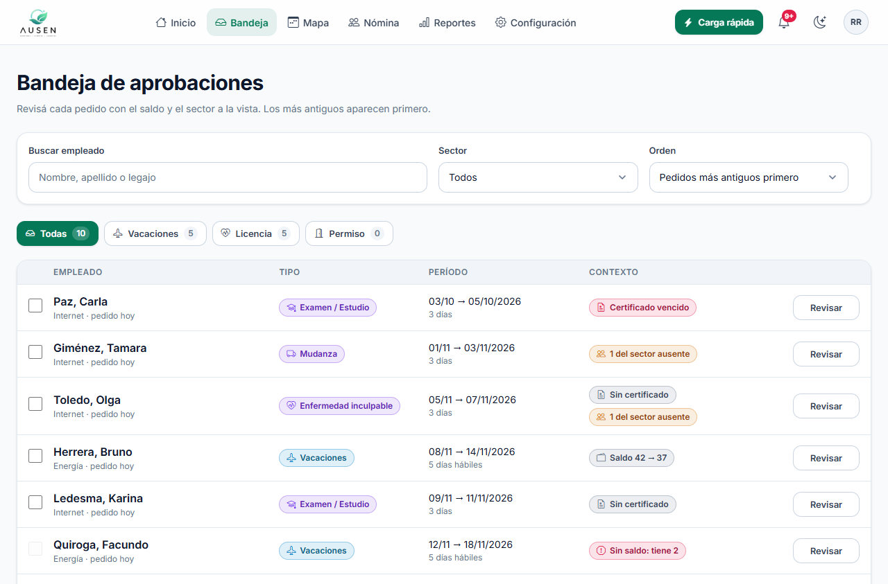
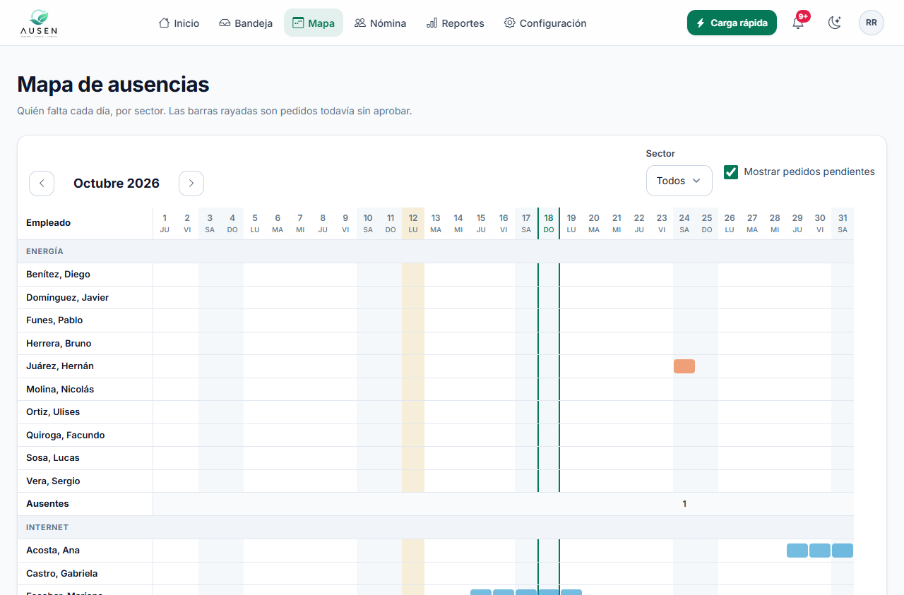
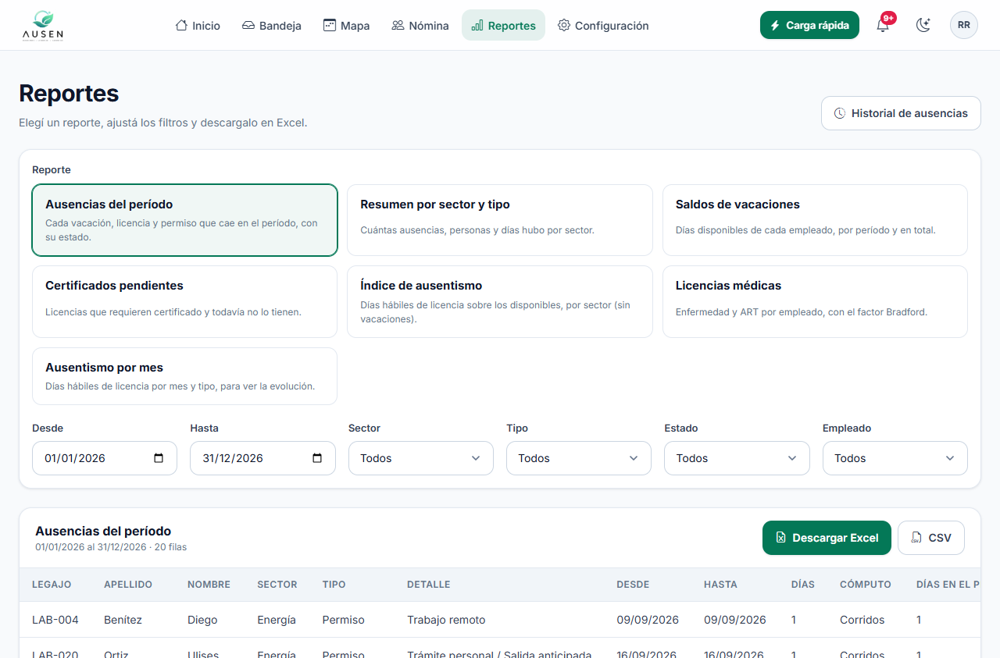
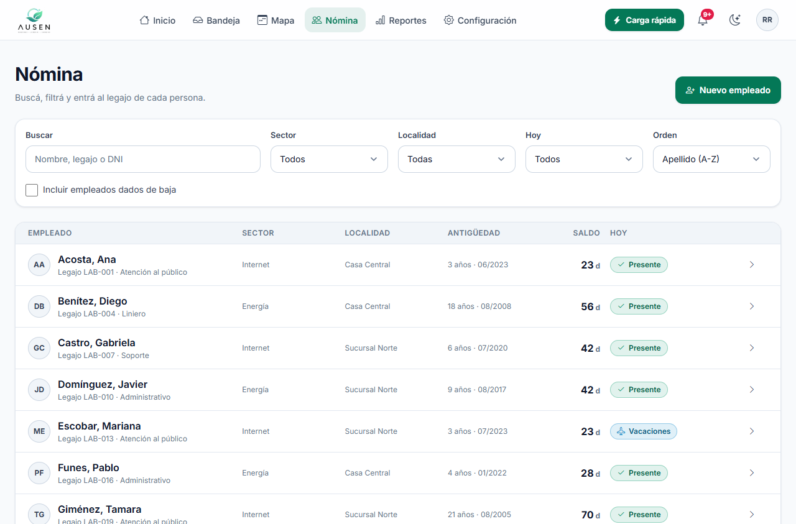
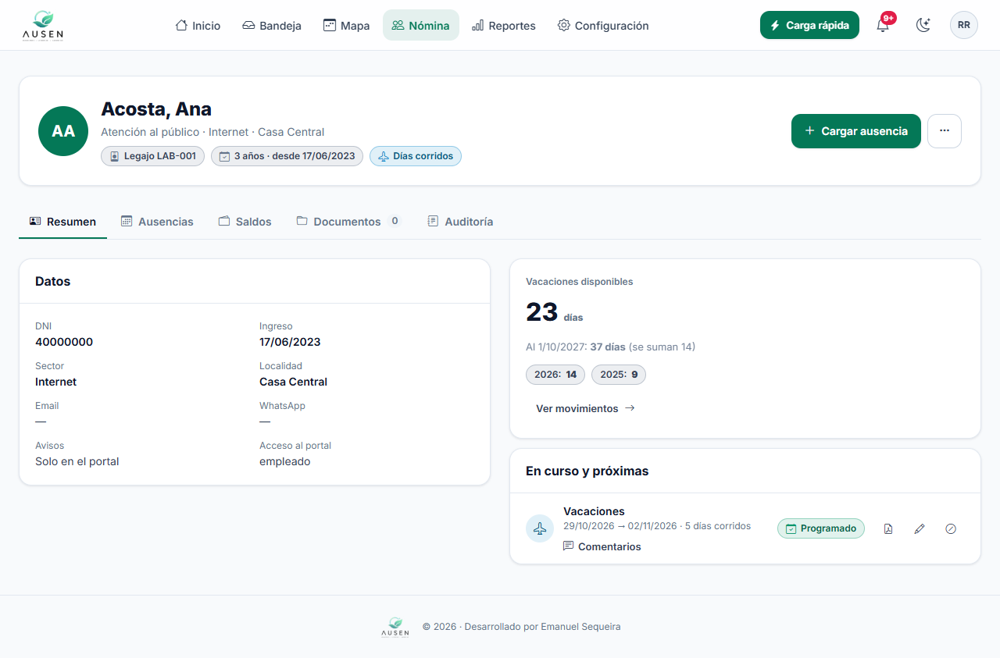
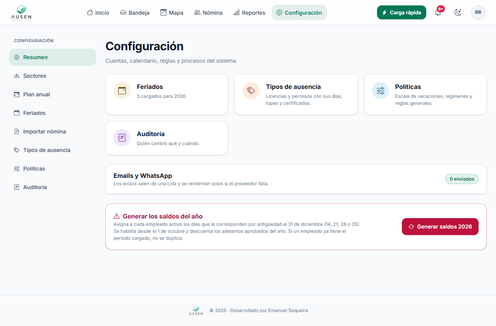
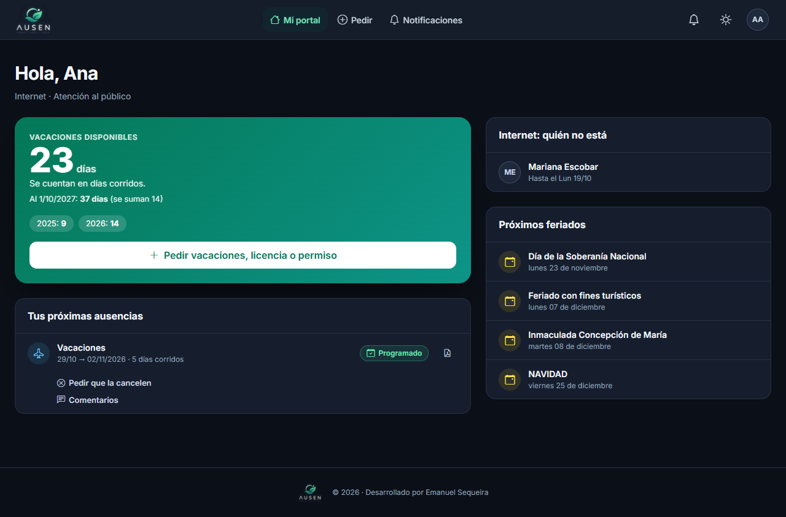
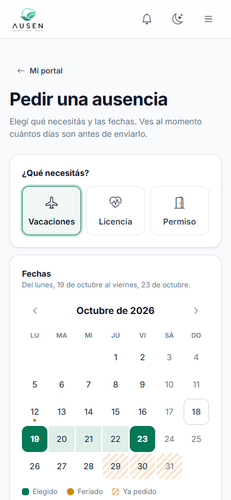

# 🍃 AUSEN
### Sistema de Gestión de Vacaciones y Licencias

**🌐 Web Oficial:** [www.ausen.com.ar](https://www.ausen.com.ar)

---

 

---

## 📋 Descripción

**AUSEN** es una solución integral desarrollada para optimizar la gestión de recursos humanos en cooperativas y PyMES. El sistema digitaliza el proceso de solicitud, aprobación y seguimiento de vacaciones y licencias, reemplazando las planillas manuales por una interfaz web intuitiva, reactiva y automatizada.

El objetivo principal es brindar transparencia a los empleados sobre sus días disponibles y facilitar a la administración el control del ausentismo mediante métricas en tiempo real.

## ✨ Características Principales

* **📊 Dashboard Interactivo:** Visualización de métricas clave (ausentismo mensual, distribución diaria, empleados activos) para la toma de decisiones.
* **📅 Motor Inteligente de Feriados:** Integración con API de feriados nacionales para importación automática al calendario.
* **⚡ Cálculo Flexible de Días:** El empleado solicita únicamente el período. Al aprobar, RRHH define si corresponde descontar **"Días Corridos"** o **"Solo Días Hábiles"**, y el sistema recalcula automáticamente fines de semana y feriados según el régimen elegido.
* **🧮 Cálculo Automático (LCT):** Algoritmo que determina los días de vacaciones correspondientes según la antigüedad del empleado (basado en la Ley de Contrato de Trabajo Argentina).
* **👥 Gestión de Empleados:** Sistema completo de administración de perfiles (ABM) con historial laboral y datos personales.
* **📩 Notificaciones Automáticas:** Envío de correos electrónicos a RRHH y supervisores cada vez que se genera o aprueba una solicitud.
* **📄 Reportes PDF:** Generación instantánea de reportes de saldos y solicitudes listos para imprimir y firmar.
* **🎨 Interfaz Moderna y Reactiva:** Diseño basado en componentes utilitarios con soporte nativo para **Modo Oscuro**, modales reactivos con Alpine.js y diseño adaptativo a dispositivos móviles.
* **🔐 Seguridad:** Sistema de autenticación robusto con panel de configuración protegido para administradores.

---

## 📸 Tour del Sistema

### Inicio y Bandeja de Aprobaciones
| Inicio | Bandeja de aprobaciones |
| :---: | :---: |
|  |  |

### Mapa de Ausencias y Reportes
| Mapa de ausencias | Reportes |
| :---: | :---: |
|  |  |

### Gestión del Personal y Perfiles
| Nómina de empleados | Legajo del empleado |
| :---: | :---: |
|  |  |

### Configuración, Modo Oscuro y Móvil
| Configuración | Portal en modo oscuro |
| :---: | :---: |
|  |  |

  
  
<i>Solicitud de ausencia desde el celular</i>

---

## 🛠️ Stack Tecnológico

* **Backend:** Python 3.10, Django Framework 5.x.
* **Frontend:** HTML5, CSS3, **Tailwind CSS 3.x** (Compilado vía PostCSS), **Alpine.js 3.x**, JavaScript.
* **Servidor de Producción:** Gunicorn (WSGI HTTP Server).
* **Contenedores:** Docker (Imagen base `python:3.10-slim` optimizada con dependencias nativas para Cairo).
* **Librerías Clave:** `holidays` (Cálculo de fechas), `xhtml2pdf` / `pycairo` (Generación de reportes PDF).
* **Base de Datos:** PostgreSQL (Producción en Neon.tech) / SQLite (Local).
* **Gráficos y Calendarios:** Chart.js, FullCalendar.
* **Despliegue e Infraestructura:** Render (Web Service basado en Docker + WhiteNoise para estáticos).
* **Control de Versiones:** Git & GitHub.

---

## 👤 Autor

**Emanuel Sequeira**
* Full Stack Developer
* [LinkedIn](https://www.linkedin.com/in/emanuel-sequeria-a8360b231?utm_source=share_via&utm_content=profile&utm_medium=member_ios)
* [GitHub](https://github.com/Manuseq94)

---

  Desarrollado con ❤️ para la gestión eficiente de equipos.

